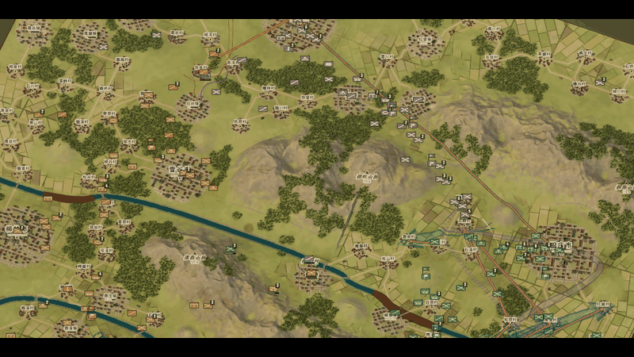
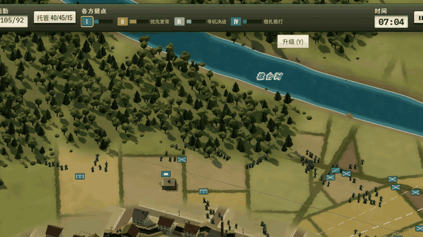
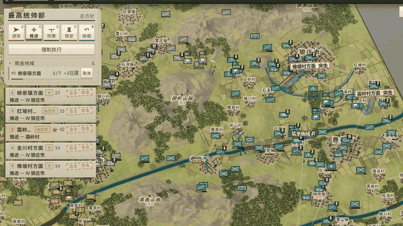
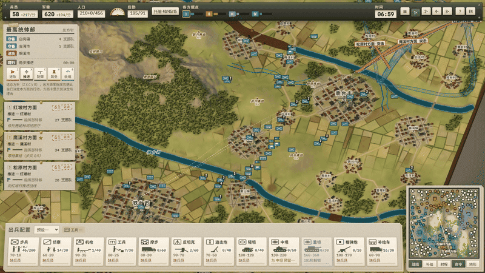
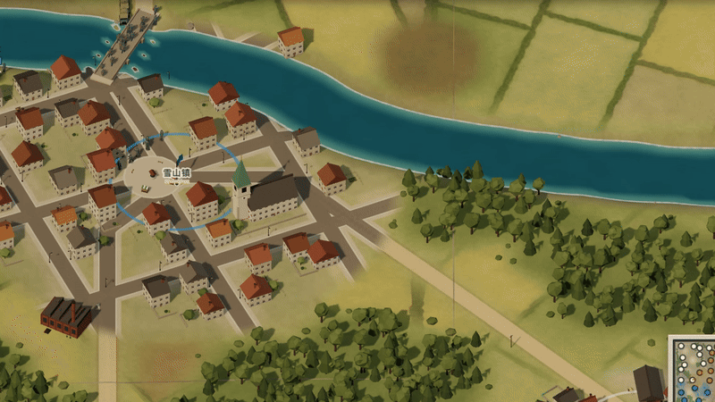
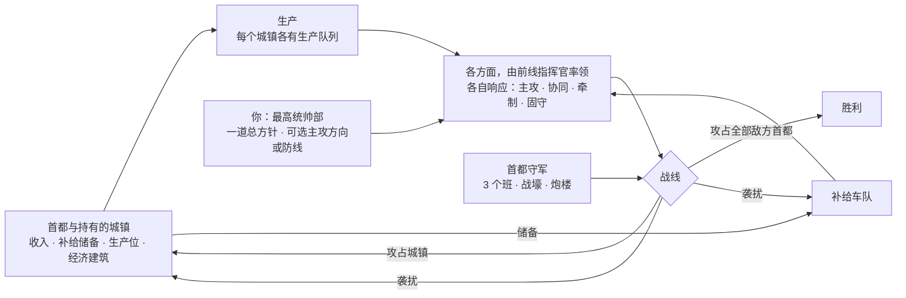
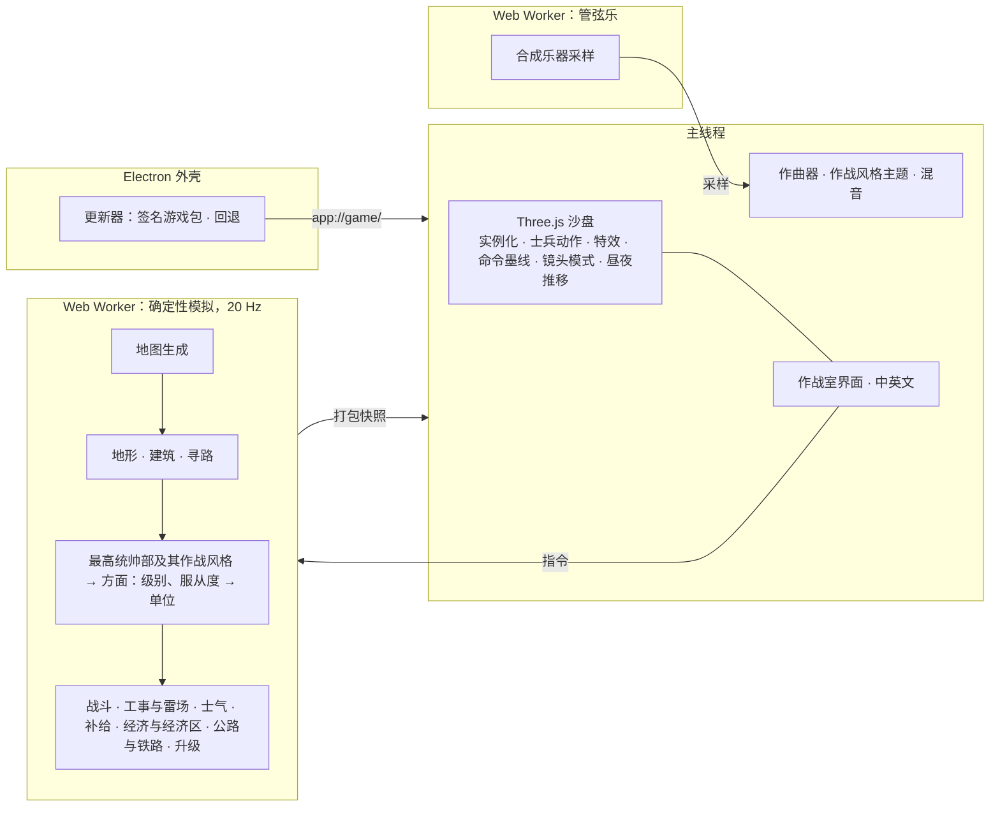

<div align="center">

[English](README.md) · **简体中文**



# LITTLE WAR · 小小战争

**二战即时战斗沙盘。** 统筹一国的战争资源，然后看成千上万的士兵在程序生成的地图上沿着真实战线作战：河流、山口、村庄、城镇与城市，每一处都值得争夺。

[](https://github.com/Zwl20085/LittleWarGame/releases/latest)
&nbsp;
[](https://github.com/Zwl20085/LittleWarGame/releases)


[3.0 新内容](#30-新内容) · [特色](#特色) · [下载](#下载与运行) · [一场战争怎么打](#一场战争怎么打) · [操作](#操作) · [技术实现](#技术实现) · [路线图](#路线图) · [从源码构建](#从源码构建)

</div>

---

## 3.0 新内容

**3.0.2 —— 装甲突击。**坦克重新成为矛头：坦克主炮和同轴机枪每次射击的弹药消耗降至十分之一（一次满载能打十倍的时间），坦克在城镇和卡车处的补给速度翻倍，轻 / 中 / 重型坦克血量提高 30%（1235 / 2730 / 4160）。反坦克炮和炮弹伤害不变，因此中坦现在要被击穿三次而不是两次。

**3.0.1 —— 斗蛐蛐模式。**现在你可以什么都不做、只看着打：默认由统帅部参谋替你运行全部 3.0 系统——**自动研究**按你的作战风格选购升级，**自动工程**修筑连接公路、修复铁路，**自动统帅**按你的作战风格选择总方针（自定义对战中在*玩家作风*里指定，快速开战随机抽取）。你下的任何命令都优先：你下达的总方针一直有效，直到你下达「稳步推进」或过了 10 分钟；每个开关都能把对应系统收回手动。步兵配属火炮升级已删除（现为 12 项升级）。

- **四种互相碰撞的 AI 作战风格。**每个 AI 最高统帅部都按一种作战风格作战，它决定生产、投资、总方针、方面行为和冒险程度。**优先发育·抢占地盘**先抢地、先搞经济，再把领先转化为一支庞大的后期军队；**优先军事·一波直捣黄龙**收缩防线、集中坦克与摩托化步兵，对敌国首都发动一次纵深进攻；**稳扎稳打·掐断部署**依托工事作战，把受损部队撤下来，方面少而密，袭扰补给车队与经济区；**寻机决战·大兵团歼灭**保有一支庞大的机械化主力，以 1.5:1 的优势寻歼孤立的敌方方面，敌军主力被击溃之前不太在乎城镇。快速开战给每个 AI 发一种不同的风格；自定义对战可以为每个 AI 指定风格或随机。敌方的风格在你与它第一次交战后（或 5 分钟后）显示在它的势力卡片上，配乐也会奏响你最强敌人的主题。在作战风格实验室（36 场一对一与 6 场四方混战）里，没有哪种风格的胜率或败率达到 75%（胜 / 负：优先发育 46 / 21%，直捣黄龙 42 / 29%，稳扎稳打 29 / 29%，寻机决战 21 / 58%）；仅凭一方的行为数据，分类器有 71–77% 的把握认出它的风格（[DOCTRINES](docs/DOCTRINES.md)，英文；[STRATEGY_LAB](docs/STRATEGY_LAB.md#30-doctrines-wp-a-docsdoctrinesmd)）。
- **方面更多，大方面更能打。**8 个方面的上限取消了（<kbd>1</kbd>–<kbd>8</kbd> 仍对应前八个，卡片列表可以滚动）。拥有 12、24、40 个作战单位的方面升格为**军**、**集团军**、**方面军**：所属炮兵集中射向同一个弹着点，命中率提高 5 / 8 / 12%，士气损失更少，补给和增援优先。兵力不足以覆盖本方面战线的会标为**战线过长**，战斗力下降。战区按每 16 个兵力或每 700 米战线开设一个方面，在成群的空闲部队所在地开设新方面，长期不足 7 个单位的方面并入邻近方面。大地图 AI 对战中，战争中期每方的方面数从 3.9 个增至 6.6 个，挑战实验室 21 场 AI 仍全部守住首都（[COMMAND_V2 §8](docs/COMMAND_V2.md#8-30--unlimited-fronts-front-tiers-directive-compliance-as-built)，英文）。
- **前线指挥官可以拒绝。**总方针不再被盲目执行。每个方面都会掂量：目标处的敌我兵力、会不会让己方城镇暴露、弹药够不够；离首都越近的方面响应越快、越痛快。拒绝执行的方面在卡片上写明理由（"拒绝执行 — 敌优势 2.4:1，将危及 Greycrest"），转而采取当地最好的行动；接受命令的方面按离首都的远近依次行动。30 秒内再下达一次同样的总方针，或打开统帅部卡片上的**强制执行**，所有方面立即服从。保卫本国首都的命令，首都附近的方面从不拒绝。
- **公路与铁路。**公路成了移动层：离开公路，坦克只有 0.6 倍速度，卡车 0.4 倍，步兵 0.75 倍，于是大军都挤上公路、路口和桥梁。铁路连接每个首都与其城市，沿线设有车站。派往远处的部队，如果两端附近都有车站、且整条线路都在本方手中，就会乘火车（一列最多载 6 个班或车辆，速度是卡车的三倍）；敌军占领线上任何一个车站都会切断线路，补给也以储备调拨的形式沿本方线路输送。工兵可以通过新的**工程**面板（<kbd>I</kbd>）修路、抢修被切断的铁路、把铁路延伸到城镇。在运输实验室里，一支 20 个单位的部队乘火车横穿大地图用时 302 秒，不用铁路要 984 秒；发生在路口 150 米内的战斗占比从 52–61% 升到 56–66%。
- **经济区可以建在任何地方。**工兵可以在本方或中立地带、远离城镇的地方建设经济区（经济面板 → **建设经济区**，再点击地图）。1 级很便宜，2 级、3 级要在经济区面板上再派工兵升级。有公路连通本方城镇的经济区全额产出，没有的减半。经济区会被炮击、袭扰、占领，也可以从废墟重建；AI 和你的自动投资会把它们放在安全、靠近公路的地方。在经济实验室里，投资经济区的"优先发育"统帅部，比同一种子下不建经济区时，20 分钟领先 602 点实力，45 分钟领先 2621 点。
- **守得住的工事。**工兵可以就地升级工事（炮楼 → 堡垒 → **要塞**，堑壕 → 加固堑壕），构筑**反坦克阵地**，布设**雷场**：车辆在雷场中减速、受损，直到敌方工兵把它扫除。有人驻守的工事观察得更远，还能为炮兵指示目标。每个首都都有一道**绝对国防圈**：五个免费的支撑点，配有机枪、火炮和堡垒级装甲，只有装甲部队才能攻下；战争迷雾下首都还有一圈观察范围。防御实验室中，同等造价、坦克领头的进攻，在开阔地胜 33%，对炮楼胜 83%，对堡垒和要塞防线一次也没赢；两排地雷击毁了 20 辆坦克中的 15 辆。
- **部队升级。**最高统帅部在首都逐项研究 12 项升级（**升级**，<kbd>Y</kbd>）：反坦克手雷、全面摩托化、坦克装甲 I–III（侧裙板）与坦克火炮 I–III（更长的炮管）、炮兵射程、卡车载量、工兵效率，以及降低方面升格门槛的参谋升级。每项升级都让下一项更贵，AI 按作战风格选购。摩托化援军 364–467 秒就赶到 1.6 公里外的城镇，同样的步兵徒步要 787 秒，甚至根本到不了。收入 1.5 倍的富裕一方在 12 场实验室战争结束时全部领先，但只有 2 场在一小时内分出胜负（第 45 和第 55 分钟）：经济优势滚雪球很慢。
- **渗透者会被抓住。**进入方面战线单位 150 米内的敌军移动速度减半并暴露位置；从两个相距不到 250 米的战线单位之间钻过去，就算接敌。各方面每隔 220 米布置警戒哨，在战线后方保留一支摩托化或坦克反应分队。深入你后方的敌军会被通报（**渗透警报**，小地图上有闪烁的圆圈），最近的空闲部队前去清剿，附近的城镇和经济区派出警戒。在渗透实验室里，越过战线而未被发现的比例从 21% 降到 0%；挑战实验室 42 场比赛中 AI 全部守住首都，包括影子突袭与偷家，代价是模拟耗时增加 5–10%（[COMMAND_V2 §9](docs/COMMAND_V2.md#9-30--sparse-fronts-and-infiltration-as-built-wp-e)，英文）。
- **调试实验室自动揪出"像 bug 的状态"。**`scripts/lab30/anomaly.ts` 完整地打一场场战争，标记缺弹扎堆、补给链断流、闲置扎堆、卡住的单位、空转的车队、空壳方面和到不了的命令，并给出成因推测。它找到了坦克没弹药还扎堆的原因：卡车一见敌人就逃离战线、满载开回仓库，部队只好走好几公里去城镇补给。现在卡车在路上遇到缺弹的部队就地交接，受威胁时只后撤 160 米。缺弹扎堆事件从 156 起降到 106 起，部队处于缺弹状态的总时长减半（2745 → 1380 个单位·时窗）（[DEBUG_LAB](docs/DEBUG_LAB.md)，英文）。
- **适合观战的镜头。**新增**环绕**（<kbd>O</kbd>）、**跟随**某个单位或方面（<kbd>F</kbd>，或双击方面卡片）、**战斗镜头**（<kbd>K</kbd>：自动找到你能看到的最激烈的战斗，每 12–20 秒切换一次）和**总览**（<kbd>Tab</kbd>，再按一次返回），过渡平滑，界面上有镜头切换条。战斗镜头遵守战争迷雾。战争的第一个小时里，光线从黎明经正午推移到黄昏（设置 → *昼夜推移*）；高画质下还可以打开低角度近景的景深。
- **自动更新。**桌面版会在后台下载每个新版本的 Ed25519 签名游戏包，校验签名、大小和哈希后，从下次启动起运行新版本（或点**立即重启更新**马上生效）。需要新外壳的版本则把安装包下载到你的"下载"文件夹，但从不自动运行。在设置里关闭*自动下载更新*即可停用。2.2.x 只有更新提示，所以 2.2 的玩家需要手动安装一次 3.0；从 3.0 起更新会自动到来（[UPDATER](docs/UPDATER.md)，英文）。
- **每种作战风格都有自己的配乐。**优先发育是田园风的弦乐，直捣黄龙是小号的短短长格节奏配上急促的固定低音，稳扎稳打是长号与定音鼓的低沉进行曲，寻机决战是圆号的奔腾三连音。新的提示音乐对应你发起的攻势、首都陷落和战斗间歇；弦乐改为四声部进行，并换上新的音乐厅混响（[MUSIC](docs/MUSIC.md)，英文）。
- **更多样的挑战实验室。**新增的脚本对手：装甲突袭、影子突袭（一支分队沿所有守军视线之外的路线潜行）、偷家、佯攻、经济战、围城，以及四种作战风格各一个。每场比赛都用玩家体验指标打分：一边倒程度、廉价胜利指数、首都陷落前的预警时间和节奏（[CHALLENGE_LAB](docs/CHALLENGE_LAB.md#30-diversity-suite-and-player-experience-metrics-wp-i)，英文）。

<details>
<summary><b>2.2 新内容</b></summary>

## 2.2 新内容

- **最高统帅部只下一道总方针。**统帅部不再给每个方面单独下命令，而是给全军下达一道总方针：**全线进攻**、**稳步推进**（默认）、**全线防御**、**筑垒固守**或**战略收缩**（<kbd>Z</kbd> <kbd>X</kbd> <kbd>C</kbd> <kbd>V</kbd> <kbd>B</kbd>）。进攻与防御可以再在地图上点一下：主攻方向，或是需要预备队的受威胁地点；筑垒固守还可以拖出一条防线，成为永备筑垒地域。随后每个方面军指挥官自行决定本方面的行动：离主攻方向最近的方面担任主攻，附近的方面协同主攻，面对 1.8 倍以上强敌的方面不去硬拼，而是牵制附近较弱的目标。方面卡片改为只读的档案，写明指挥官做了什么、为什么（"主攻 — 方向：柳泉镇"、"牵制 — 白岩镇（敌优势 2.1:1）"）。方面由战区自动开设、合并与撤销，玩家与 AI 一样；AI 最高统帅部也通过同一条命令选择总方针（[COMMAND_V2 §7](docs/COMMAND_V2.md)，英文）。统帅部面板上点击偶尔失灵的老问题已修复。
- **补给经由城镇。**你持有的首都、城市和城镇都有一份补给储备（首都最多、城镇最少，仓库可以扩容）。后勤填充储备，补给车从储备装载，城镇附近的部队从储备中逐步补充弹药，补满一次约 40 秒。人多拥挤时补给变慢，同一地区的车队交接也有上限，把卡车堆在一处没有用。单位携弹量只有 2.1 的 40%，新部队出厂时弹药为空，要先去补给再参战。城镇失守，储备也随之丢失。
- **部队在真实的地点生产。**首都、每座城市、每个城镇都有自己的生产位和生产队列（首都：全部设施；城市：兵营、车辆厂与支援；城镇：兵营），部队在哪里造好就从哪里出发。排产器把订单放在需要它的方面附近；你也可以在城镇面板里指定在某个城镇生产。据点失守或长时间被争夺，其队列会退款。
- **经济建筑与袭扰。**据点本身的收入减半，其余来自建筑：**工厂**（+军需）、**征兵站**（+兵员）和**仓库**（更大、补得更快的储备），建在城镇（2 块）和城市（3 块）边缘的空地上。它们需要时间建造，会被炮击，也会被工兵、步兵和坦克拆毁；城镇易手时建筑带着损伤留给新主人，废墟可以重建。AI 在觉得安全时投资，并派出 2—4 个班的袭扰队去拆敌方建筑；有建筑的城镇会得到守备。玩家的统帅部参谋默认也会这样自动投资（2.2.1），在经济面板关闭**自动投资**后只能手动建造。在地图上点击任意城镇即可打开**城镇面板**：储备、本地生产队列、建筑与建造按钮。
- **路边农舍可以隐蔽。**据点之间的道路旁散布着农舍、谷仓、客栈、小教堂和棚屋，间隔 150—230 米。它们是真正的建筑：有碰撞，挡炮弹和视线，也会倒塌。遭到炮击的步兵班会跑进最近的、还有空位的建筑躲避，在里面受到的爆炸伤害小得多，直到墙体倒塌。
- **坦克成群作战。**一个方面的坦克编成一个装甲群：防守时在战线后作预备队，进攻时先集结，再以步兵的步速领先步兵约 45 米。少于 3 辆坦克时不会脱离步兵单独进攻。策略实验室中，进攻时坦克所在集群的平均规模从 1.7 辆升到 2.8 辆，单车时被击毁的比例从 77% 降到 50%，坦克领头的进攻有 75% 夺取了目标（[数值实验室](docs/BALANCE_LAB.md)）。
- **反坦克炮削弱。**射程 240 → 200 米（不再比中型坦克主炮打得远），装填 4.5 → 6 秒，伤害 900 → 650，命中 .72 → .85。反坦克炮每千点花费击毁的坦克减少 37%；同等造价下，坦克领头进攻反坦克炮 + 步兵防线，在实验室中从 20 次赢 4 次变为赢 12 次。
- **快速开战默认战争迷雾。**自定义对战仍保留自己的开关。
- **检查更新。**启动时标题界面会向 GitHub 查询最新版本，若比当前版本新，就显示一条小提示和发布页链接。它不会自动下载，离线时不打扰，可在设置中关闭。标题界面也会显示版本号。
- **更流畅、更清晰。**去掉了着色器重复链接、空闲缓冲区上传和界面重排：浏览器 8 倍速下，总览每帧渲染从 7.2 降到 5.7 毫秒，近景从 5.4 降到 3.8 毫秒，各视角稳定 60 帧，周期性卡顿消失（[性能文档](docs/PERFORMANCE.md)，英文）。新增程序化地面纹理、更清晰的道路与河流、有时代感的城市天际线，经济建筑采用时代风格模型，城镇上有储备量标尺。

</details>

<details>
<summary><b>2.1 新内容</b></summary>

## 2.1 新内容

- **筑垒地域是永备工事。**一次筑垒命令就登记一个筑垒地域；之后给同一方面下达新命令不会取消它。统帅部卡片上的**筑垒地域**列表显示进度、驻守方面并可取消；地域作为模板线留在地图上，任何方面的工兵都会去完工。
- **方面数量不再受限于三个。**按 <kbd>N</kbd> 再点地图即可开设新方面（最多 8 个；指挥官花费 120 兵员，350 米内的空闲部队并入），在卡片上可撤销方面，<kbd>1</kbd>–<kbd>8</kbd> 选择方面。AI 同样最多 8 个方面，并为建成的筑垒地域开设守备方面。（自 2.2 起，包括玩家在内，各方的方面都由战区自动开设与撤销。）
- **命令是强约束。**接到你命令的方面不再外派占领、袭扰、警戒分队；突击命令不会因"敌强我弱"而停下；防御与筑垒命令让全体部队留在防线上，并优先进入工事。卡片印上**奉命**印章，展开后显示到位人数。
- **工事更划算。**炮楼 6 兵员 + 50 军需（2750 HP）自带 200 米机枪；堡垒 12 兵员 + 100 军需（5625 HP）并增强驻军火力；堑壕更便宜。首都开局就有建成的炮楼与随军工兵，工事待工时统帅部自动补充工兵。soak 测试中，工事驻守从每方 2 个班提高到全部位置的 66—93%。
- **生产顾及需求。**有工地等待而无空闲工兵时自动排产工兵（玩家同样适用；暂停工兵生产线即可关闭）。
- **脚踏实地。**单位不再悬浮：按渲染地形表面取高（而非模拟的粗网格），车辆随坡度俯仰并侧倾，阴影从脚下开始（阴影偏移随阴影贴图像素尺寸变化），每个单位都有柔和的接触阴影；新增来自镜头一侧的补光，照亮玩家真正看到的那一面。
- **有街道的城镇。**街区网格直接绘入地形（石板路、路缘、排水沟、人行道），每座城镇都有带纪念柱或水井、摊位与长椅的广场；路灯、马车、院墙、教堂墓园、工厂货场与铁路支线、乡间电线杆、烟囱炊烟。房屋现在与街道对齐（修正了布局中长期存在的朝向错误）。
- **更精细的模型。**步兵背包、铺盖卷、水壶，班里有班长和轻机枪手；坦克有各自不同的行走装置、舱盖、炮盾、外挂物，重坦有炮口制退器；卡车、火炮与指挥部参谋组同样细化；建筑有窗洞、门、烟囱、瓦楞、尖塔与锯齿形厂房屋顶。全部实例化绘制：每帧最多增加 0.4 毫秒，8 倍速依然稳定。

</details>

<details>
<summary><b>2.0 新内容</b></summary>

## 2.0 新内容

- **你就是最高统帅部。**固定的左 / 中 / 右三路战区取消了。你指挥的是各个*方面*（战线），并在地图上给每个方面下达一道常设命令：**突击**、**防御**、**筑垒防守**、**回防**或**自主**。左键点选一个地点，按住拖动则画出一条战线。每道命令都会以作战地图上的墨线画出，并盖上写有方面名称的印章。远离所有方面的命令会开辟一个新方面（最多 4 个）。AI 最高统帅部同样会开辟、合并、撤销自己的方面，并通过与你相同的命令接口下达命令（[docs/COMMAND_V2.md](docs/COMMAND_V2.md)）。
- **前线指挥官。**每个方面都由地图上的一名指挥官率领：四人参谋组（看地图的军官、报务员、两名警卫）和一面指挥部三角旗，生命值 2400。指挥官驻扎在战线后方最近的、安全的己方城镇，在你的命令范围内自行选择目标、姿态、作战方式和战线位置。指挥官阵亡后，该方面只能原地固守约一分钟；90 秒后会任命继任者。
- **炮楼与堡垒。**工兵可以修建炮楼（10 兵员 + 80 军需，70 秒，2200 生命值，容纳一个班，内置机枪，后方有射击盲区）和堡垒（20 兵员 + 160 军需，120 秒，4500 生命值，容纳两个班或一门反坦克炮）。**筑垒防守**命令会沿你画的战线布设筑垒地域：战壕、两端各一座炮楼、中段后方一座堡垒。每座首都从开局最初几分钟起就有 3 个班的常驻守军，以及工兵修建的 2 道战壕和 2 座炮楼组成的防线。
- **装甲与摩托化突破。**拥有 3 辆以上空闲坦克或摩托化步兵班的方面，局部兵力优势达到 1.5 倍即可发动突破，每 75 秒一次，由装甲和摩步打头阵。参与突破的摩托化步兵在敌人进入 220 米之前一直乘车。中型坦克改为 2100 生命值、2.8 米/秒、主炮 130 伤害，轻型坦克速度 3.3 米/秒。坦克能敲开混凝土：重坦 4 发、中坦 7 发即可摧毁一座炮楼。2.0 时反坦克炮仍是最好的坦克杀手（坦克损失中由它造成的比例从 13% 升到 21%，[数值文档 §2.7](docs/BALANCE_SPEC.md)）；2.2 把它削弱了，装甲突击重新划算。
- **挑战实验室。**`scripts/challenge.ts` 让一方以预设脚本策略作战（3 / 5 / 10 分钟速攻、龟缩、双路进攻、袭扰、后期闪击、模拟真人、全军直扑首都），通过真实命令接口对抗另外三方 AI，并报告 AI 是否守住了首都、如何防守（[docs/CHALLENGE_LAB.md](docs/CHALLENGE_LAB.md)，英文）。
- **更有分量的火力。**爆炸效果取决于命中了什么：水花、倒塌建筑扬起的尘土与瓦砾、屋顶命中、穿甲弹火花、车辆殉爆。火炮喷出锥形炮口焰并带出烟圈，曳光弹更亮，残骸持续燃烧、火星逐渐熄灭，长时间遭炮击的地面笼罩着一层淡淡的硝烟（高画质档）。
- **依然很快。**敌距离变换改用更粗的网格（占模拟 CPU 从 2.8% 降到 0.8%），防御位置与掩体搜索结果被缓存，工事查找改用每步建立的索引。2.0 的统帅部规划每 5 秒运行一次，不增加每步开销。浏览器中，全图视角每帧渲染 4.8 毫秒，战斗视角 3.3—3.5 毫秒，8 倍速依然稳定。

</details>

<details>
<summary><b>1.1 与 1.0 新内容</b></summary>

**1.1**

- **更强的炮兵。**迫击炮和榴弹炮会对移动目标打提前量，炮弹也不再炸在自家炮位上。炮弹威力和爆炸范围都更大（榴弹 180 伤害、半径 16 米，迫击炮弹 125 伤害、半径 11 米），两门炮几轮齐射就能打垮一个暴露在开阔地的步兵班。榴弹炮数量上限降低、造价下调，炮兵击杀约占总数的五分之一。
- **兵种身份核对。**逐一核对每个兵种的伤害与生命值是否符合名字给人的印象。重型坦克主炮伤害 150 → 210，平衡规格文档与数据表重新一致。
- **统帅部保卫首都。**统帅部会预判首都受到的威胁，召回离得最近、交战最少的部队，派出守备队，并在来敌方向挖掘环形堑壕。策略实验室中，本可挡住的进攻导致的首都失守从 7 次降到 0 次（6 个种子 × 45 分钟）。
- **围城与总攻。**面对设防的首都，部队合围、把所有火炮推进到射程内，兵力足够时发起总攻，攻势受挫就就地挖壕。
- **炮组部署到交火处。**机枪和反坦克炮会前往战线上真正接敌的地段，开火次数约增加一倍。
- **按领土计算的人口上限。**人口上限随所控领土增长。胜利仍只有攻占全部敌方首都一种方式。
- **再次提速。**快照应用耗时减半，场景对象减少约四分之一（[docs/PERFORMANCE.md](docs/PERFORMANCE.md)）。

**1.0**

- **士兵像人一样行动。**每名士兵以有限的步速走向自己在队形中的位置，逐渐转身，步幅随实际走过的距离变化。
- **地形与建筑参与战斗。**步兵班可以驻守房屋、从窗口射击，直到高爆弹把房屋打塌。高地射得更准、看得更远，山脊能掩护守军，林中不开火的部队难以被发现。
- **管弦配乐**，逐小节实时作曲，由 Worker 中合成的管弦乐演奏。
- **更聪明的 AI。**依据策略实验室重新调整作战方式的选择规则，作战成功率从 42% 提高到 58%。
- **更快。**约 460 个单位时，模拟每步平均耗时从 4.5 毫秒降到 2.7 毫秒，并新增**画质**设置。

</details>

## 特色

<div align="center">

<br/><sub><b>四种作战风格，四种打法。</b>每个 AI 最高统帅部都按一种作战风格作战：优先发育、直捣黄龙、稳扎稳打、寻机决战。与敌人交过手后，它的风格就显示在顶栏的势力卡片上，鼠标移上去可以看到全称。下面是其中两种：直捣黄龙的大军冲进敌方城市，稳扎稳打的袭扰分队出发前往敌后的村庄。</sub>
</div>
<br/>

<div align="center">

<br/><sub><b>会回话的方面。</b>方面数量随战争需要而定，大的方面升格为<i>军</i>、<i>集团军</i>或<i>方面军</i>：炮兵集中射击、命中与士气更好、补给优先。这里玩家下令向一座敌国首都全线进攻：离首都近的方面几秒内受命，第四方面面对 2.9:1 的敌军拒绝执行，并在卡片上说明理由。按下<b>强制执行</b>，所有方面一齐进攻。</sub>
</div>
<br/>

<table>
  <tr>
    <td width="50%"></td>
    <td width="50%"></td>
  </tr>
  <tr>
    <td><b>公路与铁路。</b>离开公路，坦克、卡车和步兵都会慢下来，战斗于是集中在路口和桥梁。派往远处的部队，只要本方完整控制的铁路线经过两端附近，就会乘火车；车站落入敌手，线路即被切断。工兵可以修路、抢修与延伸铁路。这里一列火车在城市车站接上部队，沿本方线路过河；随后工兵在两座村庄之间修通一条公路。</td>
    <td><b>经济区。</b>工兵可以在远离城镇的空地上建设经济区，并升到 2 级、3 级。有公路连通本方城镇的经济区产出翻倍。经济区也是目标：敌人会炮击、袭扰它，它也随土地易手。这里玩家在田间道路旁选址，再把它从 1 级升到 2 级。</td>
  </tr>
  <tr>
    <td width="50%"></td>
    <td width="50%"></td>
  </tr>
  <tr>
    <td><b>守得住的工事。</b>炮楼可以升级为堡垒和要塞，堑壕可以加固，反坦克炮可以掘壕固守，雷场让车辆减速、受损，直到工兵把它扫除。每个首都都有一道免费的国防圈支撑点，只有装甲部队才能攻下。同等造价下，坦克领头的进攻在开阔地赢三分之一，对堡垒和要塞防线一次也没赢。画面里依次是：带守军的国防圈支撑点、首都来路上的反坦克阵地、闯进雷场的重型坦克（雷场由录制脚本布设在它的路线上）。</td>
    <td><b>部队升级。</b>首都每次研究一项：反坦克手雷、全面摩托化、坦克装甲（侧裙板）与坦克火炮（更长的炮管）各三级、炮兵射程、卡车载量、工兵工具和参谋作业。坦克和步兵班下一次在城镇补给时换装。画面里玩家开始研究坦克装甲 I；出镜的坦克装有装甲 II 和火炮 III。（此片段录于 3.0.1 之前，3.0.1 已删除配属火炮升级。）</td>
  </tr>
  <tr>
    <td width="50%"></td>
    <td width="50%"></td>
  </tr>
  <tr>
    <td><b>不再能从战线中间穿过去。</b>靠近方面战线单位的敌军会减速并暴露，警戒哨守住空隙，战线后方有反应分队待命。仍然钻过来的袭扰会被通报，小地图上闪起圆圈，最近的空闲部队前去清剿，后方城镇派出警戒。这里六个敌方步兵班钻进了后方深处：它们被通报、被减速，一路被盯着走向城镇。</td>
    <td><b>适合观战的镜头。</b><kbd>K</kbd> 是战斗镜头：找到你能看到的最激烈的战斗，框好画面，再切到下一处。<kbd>F</kbd> 跟随选中的单位或方面，<kbd>O</kbd> 环绕，<kbd>Tab</kbd> 飞到总览再飞回来。</td>
  </tr>
</table>
<br/>

<div align="center">

<br/><sub><b>一道总方针，各方面自行响应。</b>先选总方针（<kbd>Z</kbd> <kbd>X</kbd> <kbd>C</kbd> <kbd>V</kbd> <kbd>B</kbd>），需要时再在地图上点选主攻方向。这里玩家下令向一座敌方城镇全线进攻：最近的方面担任主攻，其余方面协同，每张卡片都写明了各自的决定。左上：最高统帅部卡片（总方针栏），下面是每个方面一张只读卡片（第一张已展开）；底部：生产栏；右下：小地图。默认中文，一键切换英文。</sub>
</div>
<br/>

<div align="center">

<br/><sub><b>城镇撑起战争经济。</b>点击城镇打开面板：补给储备（附近部队从这里补充弹药）、本城的生产队列与生产位、经济建筑。这里工厂已经在产出军需，玩家在第二块空地上修建征兵站，并排产一个将从这座城镇出发的步兵班。</sub>
</div>
<br/>

<table>
  <tr>
    <td width="50%"></td>
    <td width="50%"></td>
  </tr>
  <tr>
    <td><b>路边的农舍就是掩体。</b>据点之间的乡间道路旁散布着单独的农舍、谷仓、客栈、小教堂和棚屋。炮弹落下时，暴露在开阔地上的步兵班会跑向最近的、还有空位的建筑并进去隐蔽：在里面受到的爆炸伤害小得多，墙体替他们挡住炮火，直到倒塌。</td>
    <td><b>坦克在前，步兵在后。</b>一个方面的坦克进攻前先集结成一群，然后以步兵的步速领先约 45 米推进，而不是一辆接一辆零散地冲上去。坦克少于三辆的方面不会让坦克脱离步兵单独进攻。全线进攻时，新造与空闲的坦克向主攻方向集中。</td>
  </tr>
  <tr>
    <td width="50%"></td>
    <td width="50%"></td>
  </tr>
  <tr>
    <td><b>看得见的前线指挥官。</b>每名指挥官都是一个四人参谋组，竖着指挥部三角旗。指挥官驻扎在战线后方最近的安全己方城镇，只在自卫时开火，敌方武装部队靠近就后撤。它为本方面响应你的总方针：选择目标、姿态和作战方式，方面卡片会说明理由。指挥官阵亡后，该方面约一分钟内只守不攻；只要统帅部付得起，90 秒后就会任命继任者。</td>
    <td><b>炮楼、堡垒与筑垒地域。</b>由工兵修建，步兵班停在旁边就会进驻。炮楼里的班使用内置机枪，后方有射击盲区；堡垒可容纳两个班或一门反坦克炮。驻军在开火之前一直处于隐蔽状态。建筑不占人口。坦克能把它们敲开，但穿甲弹对混凝土的伤害有上限。</td>
  </tr>
  <tr>
    <td></td>
    <td></td>
  </tr>
  <tr>
    <td><b>装甲突破。</b>拥有空闲坦克或摩托化步兵的方面，只需比步兵方面更小的局部优势就能发起突破：装甲打头，摩步乘车跟进，直到接近敌人才下车。轻型坦克负责扩大突破口，中型坦克有足够的生命值和火力领头突破。担任矛头的坦克会等自己的步兵，不再单车冒进。</td>
    <td><b>效果取决于命中的目标。</b>炮弹落入河中溅起水花，把房屋炸塌成尘土和瓦砾，在屋顶上爆炸，在装甲上擦出火花。车辆会殉爆，残骸持续燃烧。火炮喷出锥形炮口焰与烟圈，长时间遭炮击的地面笼罩着淡淡的硝烟。</td>
  </tr>
  <tr>
    <td></td>
    <td></td>
  </tr>
  <tr>
    <td><b>看得见的炮兵。</b>迫击炮和榴弹炮弹沿真实弹道越过山脊和屋顶，拖着发光尾迹，在墙面或田野上爆炸。炮手会对移动目标打提前量，一发炮弹就能把暴露在开阔地的步兵班炸散。开火的炮兵会被敌方声测定位，几轮齐射后必须转移阵地。</td>
    <td><b>真实战线，而不是兵线。</b>控制区由部队实际位置计算。各方面占据有利地形、局部优势时推进，并从薄弱处发起突破。坦克足够坚固，可以担任进攻矛头。反坦克炮依然能重创坦克，但自 2.2 起，领着步兵推进的坦克群可以突破反坦克炮防线。</td>
  </tr>
  <tr>
    <td></td>
    <td></td>
  </tr>
  <tr>
    <td><b>城镇是实体，值得死守。</b>每栋建筑都有碰撞体积：部队沿街道行进，墙体会阻挡视线、直射火力和炮弹。每个城镇都提供收入、生产位、补给储备、人口和经济建筑用地，因此最高统帅部会为受威胁的城镇派驻守备，并派小队占领空置据点。</td>
    <td><b>河流塑造战争。</b>河流沿谷地蜿蜒，有桥梁和浅滩。各方面在渡口前集结、强渡；若最近的渡口绕路太远，工兵会架设浮桥。</td>
  </tr>
  <tr>
    <td></td>
    <td></td>
  </tr>
  <tr>
    <td><b>每张地图都是新的。</b>每个种子都会生成一张大地图（四方对战约 3.6 公里见方），包含带山口的山脉、谷地河流、森林、田野、上百个村庄、街区式城镇、带高楼的城市，以及每方一座首都。</td>
    <td><b>看得见、也打得断的补给。</b>后勤填充首都和每个持有城镇的补给储备（距离越远效率越低），补给车在那里装载，把弹药运往前线。部队逐步补充弹药，人多拥挤时补得更少；被攻势抽空的前沿城镇需要时间才能重新补满。渗透部队穿过敌线薄弱处伏击车队、拆毁经济建筑，后方警戒部队与守备队负责清剿。</td>
  </tr>
  <tr>
    <td></td>
    <td></td>
  </tr>
  <tr>
    <td><b>是士兵，不是棋子。</b>每名士兵以步行速度走向自己在队形中的位置，逐渐转身，步幅随走过的距离变化，脚下不会打滑。在道路上，步兵班以单列或纵队行军，沿领头者的路线依次转过弯道。火炮转向时，炮组成员绕着火炮走动。</td>
    <td><b>地形与建筑参与战斗。</b>步兵班躲在房屋背敌一侧、从窗口射击，在这一侧获得重掩护，直到高爆弹把房屋打塌。教堂与塔楼可作观察哨。在林中不开火的部队只有靠近才会被发现。占据高地射击更准、炮兵观测更精确，山脊能让守军躲过来自坡下的火力。渡口与桥上的部队无处隐蔽。前线指挥官会把防线贴合到有利地形上：城镇和林地朝敌的边缘、山脊与建筑背面。</td>
  </tr>
</table>

### 作战方式、围城与作战倾向


在你的命令范围内，每名前线指挥官进攻时都会选用一套**作战方式**，以作战室风格的箭头画在你的命令墨线下方。指挥官依据该方面的兵力构成、目标和作战倾向来选择：

| 作战方式 | 部队行动 |
|---|---|
| **正面推进** | 全线稳步推进。 |
| **侧面迂回** | 机动部队（坦克、摩托化步兵、侦察）绕到较弱一侧的集结点，完成集结后从侧面突击；正面部队负责牵制。 |
| **钳形攻势** | 左右两翼同时迂回，合围同一目标。 |
| **武装渗透** | 小股步兵从敌线最薄弱处渗透，直取目标。 |
| **筑垒围攻** | 针对有守军的城镇：在直射距离外合围并挖掘堑壕，待守军被消耗后发起总攻。 |

<table>
  <tr>
    <td width="50%"></td>
    <td width="50%"></td>
  </tr>
  <tr>
    <td><b>野战工事。</b>围城方挖掘之字形堑壕，守军堆砌沙袋街垒。首都受到威胁时，会在常设的战壕与炮楼防线之外，再在来敌方向挖出一圈堑壕。躲在完工工事后的部队，对来自正面的炮击和火力享有最好的掩护，任何一方都无法单靠炮兵把对方轰出地图。构筑工事消耗兵员。</td>
    <td><b>摩托化步兵。</b>长途安全行军时乘卡车机动，接近敌人、遭到射击或到达目的地时下车作战；参与装甲突破时，敌人进入 220 米前一直乘车。适合迂回和快速占点，但乘车时较为脆弱。</td>
  </tr>
</table>

**作战倾向。**开战前可选择*均衡*、*步兵优先*、*装甲优先*、*机动优先*或*炮兵优先*。作战倾向决定你的生产配比，以及前线指挥官偏好的作战方式；每个 AI 阵营也各有自己的作战倾向。3.0 起，每个 AI 最高统帅部还按四种作战风格之一作战（优先发育、直捣黄龙、稳扎稳打、寻机决战，见 [3.0 新内容](#30-新内容)），它影响的不只是生产配比，还有投资、总方针、袭扰、方面密度与冒险程度。

此外还有：
- **领土就是经济。**仅靠首都只能维持约三分之一的满编部队。村庄提供兵源（兵员），城镇和城市提供工业（军需）、生产位、补给储备、人口和经济建筑用地。自 2.2 起，据点本身只有原来一半的收入，其余靠建筑补上。动员与工业配比会影响全部领土的产出；丢失领土会削弱战争能力，损失的部队需要时间和资金才能补充。花在工厂上的每一点兵员和军需，都是少造的一个班，经济与军队之间是真正的取舍。
- **成千上万的士兵。**数百个战术单位（步兵班、火炮、坦克、卡车），采用实例化渲染。步兵班的队形随情况变化（道路上成单列，行进中成楔形或分组，交火时成散兵线），远景时用部队标记保持画面清晰。
- **管弦配乐。**音乐跟随战况：平静的主旋律，战斗逼近时的紧张主题，激战中的战斗固定音型，丢失领土时的挽歌，以及胜利、失败与敌方首都陷落时的短乐句。作曲器以 8 小节乐句逐小节写作，带声部进行的和声与按种子变化的配器，由在 Worker 中合成的弦乐、圆号、铜管、木管、定音鼓与小军鼓演奏。步枪齐射、机枪点射、火炮与炮弹呼啸同样是合成的，游戏不带任何音频文件；`npx vite-node scripts/music-preview.ts` 可以把配乐渲染成 WAV 文件离线试听。
- **规则先行。**装甲朝向与穿深、高爆杀伤、掩体、压制、士气以及受地形和建筑遮挡的视线，都依照成文的数值规范实现。

## 下载与运行

| | |
|---|---|
| **Windows（推荐）** | 从 **[Releases](https://github.com/Zwl20085/LittleWarGame/releases/latest)** 下载。`LittleWar-<版本>-portable.exe` 是单文件，无需安装；`LittleWar-<版本>-setup.exe` 是安装版，带开始菜单与桌面快捷方式。 |
| **任意系统，从源码运行** | `npm install` 后执行 `npm run dev`，打开 http://localhost:5173；或用 `npm run app` 以桌面窗口运行。 |

> [!NOTE]
> Windows 版尚未进行代码签名，首次启动时 SmartScreen 可能会拦截，请选择**更多信息 → 仍要运行**。需要支持 WebGL2 的显卡（近 8 年内的显卡基本都可以）。按 **F11** 切换全屏。

**更新。**从 3.0 起，桌面版会自己更新：每个版本都附带一个签名游戏包，程序下载后用内置公钥校验，从下次启动起运行新版本；如果新版本无法启动，程序会退回随安装包附带的版本。需要新桌面外壳的版本，会把新安装包保存到你的"下载"文件夹，由你自己运行。**从 2.2.x 升级？**2.2 只能提示你去发布页，所以需要手动下载安装一次 3.0，之后的更新会自动到来。原理与安全设计见 [docs/UPDATER.md](docs/UPDATER.md)（英文）。

## 一场战争怎么打



1. **动员。**首都、城市和城镇按底部生产栏的权重出兵，各用自己的生产队列，并投资工厂、征兵站和仓库。资源管家会自动平衡动员、工业与后勤，你也可以手动设定。新部队会加入需要它的方面，但要先到最近的储备或补给车领取弹药；主攻方面优先获得增援与补给。
2. **指挥。**你是最高统帅部。给全军下达一道总方针：**全线进攻**（可指定主攻方向）、**稳步推进**、**全线防御**（可指定受威胁地点）、**筑垒固守**（可沿你画的线构筑），或**战略收缩**到最近的己方城镇一线。每个前线指挥官为本方面作出响应：目标、姿态、作战方式、贴合地形的战线、渡河与装甲突破，卡片上写明他的选择。需要时，你仍然可以选中部队直接下令。
3. **守住首都。**开局最初几分钟起，每座首都都有 3 个班的常驻守军，工兵还会在首都前方修建 2 道战壕和 2 座炮楼。预判到威胁时，统帅部会召回最近的方面，并在来敌方向加修工事。
4. **争夺土地。**地图上百余个据点都可以占领。每占下一处，都会充实自己的经济，同时削弱敌方的经济；攻下的城镇里的经济建筑带着损伤归新主人所有。
5. **获胜。****首都**被敌方步兵攻占的一方即被淘汰；只有攻占全部敌方首都才能结束战争。没有士气条、没有时间限制、也没有领土比例裁定：丢了一半国土仍可翻盘。

## 操作

**最高统帅部总方针**（主要玩法）

| 输入 | 作用 |
|---|---|
| <kbd>Z</kbd> <kbd>X</kbd> <kbd>C</kbd> <kbd>V</kbd> <kbd>B</kbd> 或统帅部卡片上的按钮 | 下达总方针：全线进攻 · 稳步推进 · 全线防御 · 筑垒固守 · 战略收缩 |
| 地图上左键单击（全线进攻、全线防御、筑垒固守之后） | 可选：指定主攻方向，或需要预备队的受威胁地点 |
| 左键拖动（25 像素以上，筑垒固守之后） | 可选：画出一条防线，成为永备筑垒地域 |
| 点选时按住 <kbd>Shift</kbd> | 保持选中，可以再点一次 |
| 右键或 <kbd>Esc</kbd> | 跳过可选的点选（总方针照常生效） |
| 统帅部卡片上的**强制执行**，或 30 秒内再次下达同一总方针 | 所有方面立即执行，不得拒绝 |
| <kbd>1</kbd>–<kbd>8</kbd> 或点击方面卡片 | 展开或收起该方面的档案：对总方针的响应（或拒绝的理由）、级别、作战方案、到位情况与兵力 |
| 统帅部卡片上的"筑垒地域"列表 | 每个永备地域的进度；取消只停止施工，已建工事保留 |
| 在地图上点击城镇或城市 | 城镇面板：补给储备、本地生产队列（可在此排产）、经济建筑（建造或重建） |

方面由战区自动开设、合并与撤销，不再有对应的按键。方面数量不设上限：前八个有快捷键，卡片列表可以滚动。

**工程、经济与研究**

| 输入 | 作用 |
|---|---|
| <kbd>I</kbd> 或经济面板上的**工程** | 工程面板：**修路**（点两个点，或拖动）、**修复铁路**（两端都在本方手中的断线）、**延伸铁路**（先点本方车站，再点本方城镇） |
| 经济面板（顶栏的*自动*按钮）→ **建设经济区**，再点击地图 | 在本方或中立地带选址建设经济区：远离城镇、靠近公路 |
| 点击经济区 | 经济区面板：等级、产出、公路连通、完好度；升到下一级，或重建废墟 |
| <kbd>Y</kbd> 或**升级** | 技术升级面板：在首都逐项研究，查看计时，取消可返还部分费用 |
| **自动投资** / **自动研究**（经济面板）、**自动工程**（工程面板）、**自动统帅**（统帅部卡片） | 默认开启：由统帅部参谋替你投资、研究、修路 / 修铁路、选择总方针；关闭某一项即由你接管（你下达的总方针会暂停自动统帅，直到你下达「稳步推进」或过了 10 分钟） |

**自定义对战：**除了你自己的作战倾向（生产配比）和*玩家作风*（自动统帅与自动研究依此行事），还可以为每个 AI 指定作战风格（*优先发育*、*直捣黄龙*、*稳扎稳打*、*寻机决战* 或 *随机*）。快速开战和观战模式随机分配，四方混战中各不相同。

**部队**（可选的直接控制）

| 输入 | 作用 |
|---|---|
| 左键单击 / 框选 | 选择部队（<kbd>Shift</kbd> 追加） |
| 右键地面 / 敌人 | 移动 / 集火（<kbd>Ctrl</kbd>：移动后固守，<kbd>Shift</kbd>：排队） |
| <kbd>A</kbd> <kbd>H</kbd> <kbd>R</kbd> <kbd>G</kbd> | 攻击移动 · 原地坚守 · 撤退 · 归建 |

**镜头与游戏**

| 输入 | 作用 |
|---|---|
| <kbd>W</kbd><kbd>A</kbd><kbd>S</kbd><kbd>D</kbd> 或中键拖动，<kbd>Q</kbd>/<kbd>E</kbd>，滚轮 | 平移 · 旋转 · 缩放 |
| <kbd>[</kbd> / <kbd>]</kbd>、<kbd>PgDn</kbd>/<kbd>PgUp</kbd> 或 <kbd>Ctrl</kbd>+滚轮 | 镜头俯仰 |
| <kbd>O</kbd> · <kbd>K</kbd> | 环绕 · 战斗镜头（自动对准你能看到的最激烈的战斗，每 12–20 秒切换） |
| <kbd>F</kbd>，或双击方面卡片 | 跟随选中的单位，否则跟随展开的方面 |
| <kbd>Tab</kbd> | 总览；再按一次飞回原处 |
| 界面上的镜头切换条 | 自由 · 环绕 · 跟随 · 战斗 · 总览 |
| <kbd>空格</kbd> <kbd>U</kbd> <kbd>Esc</kbd> | 暂停 · 隐藏界面 · 回到自由镜头 / 取消 / 菜单 |
| <kbd>F11</kbd> · <kbd>Ctrl</kbd>+<kbd>Shift</kbd>+<kbd>I</kbd> | 全屏 · 开发者控制台（桌面版） |

游戏速度：1× / 2× / 4× / 8×。如果模拟跟不上，游戏会降速并给出提示，绝不跳帧。

**画质**（标题界面或 Esc 菜单中的设置）：*自动*（默认）、*高*、*中*、*低*。自动模式按显卡推测起始档位，在约 3 秒帧率偏低后降一档，并给出提示。

**快速开战**默认开启战争迷雾；自定义对战有自己的迷雾开关，观战模式可看到全部信息。**更新：**标题界面启动时检查是否有新版本（设置 →*启动时检查更新* 可关闭）。桌面版会在后台下载并校验新版本，标题界面随后提供**立即重启更新**；设置 →*自动下载更新* 关闭后只保留带发布页链接的提示。浏览器版始终是最新版本。

## 技术实现



- **确定性模拟。**固定 20 Hz 步进与带种子的随机数：同一种子加同样的指令，会得到同一场战争，有测试专门检查这一点。模拟运行在 Web Worker 中，主线程只负责绘制。
- **所有人共用一套指挥层级。**最高统帅部（你，或 AI 规划器）决定战争资源，下达一道总方针，可附主攻方向或防线；战区为每一方开设、合并、撤销方面并维持首都守军。每个前线指挥官把总方针转化为本方面的响应（主攻、协同、牵制、固守、反击、后撤），再决定目标、姿态、作战方式、战线槽位、渡河与突破；单位决定射击目标与掩体。AI 最高统帅部每 5 秒思考一次，与界面发出的是同一条 `setDirective` 命令（[COMMAND_V2 §7](docs/COMMAND_V2.md)、[策略实验室第 6 轮](docs/STRATEGY_LAB.md)，英文）。3.0 起，每个方面通过一个服从度（离首都远近、当地风险、指挥官性格）作出响应；方面的规划按每步 8 个分批错开，开销随每 5 秒一次思考中的方面数增长，而不是每步都增长（[COMMAND_V2 §8](docs/COMMAND_V2.md)，英文）。
- **作战风格是"旋钮"，不是第二套 AI。**`docs/data/rules.json` 中的作战风格配置（`doctrines`）调节的是 AI 原本就在读取的参数：生产配比与上限、投资、占领、防御与进攻阈值、撤退血量、袭扰目标、方面密度、服从性格、主攻份额和升级优先级。结束战争的终结者规则仍然优先（[DOCTRINES](docs/DOCTRINES.md)，英文）。
- **运输是一层移动规则。**速度与寻路代价取决于移动类别（履带、轮式、徒步、牵引）以及所在格是不是公路或城镇街道；卡车在自己的轮式寻路网格上找路。铁路由地图生成，不额外消耗随机数，所以同一种子的地形不变；归属、切断、列车和工兵工程都是快照里的普通数据（[rules.json](docs/data/rules.json) 的 `transport`）。
- **每个 3.0 系统都有开关和实验室。**每个系统都带有 `rules.json` 配置块、用于 A/B 的 `enabled` 开关、单元测试和 `scripts/lab30/` 里的实验套件；全部开启时确定性回放测试依然通过。
- **以据点为单位的后勤。**每个持有的据点都是一个补给节点：有储备、补给半径、自己的生产位和队列，以及经济建筑用地；储备与建筑随快照传到主线程，供城镇面板和储备标尺使用。补给按速率进行并有拥挤惩罚，车队交接按 200 米网格限量。数值都在 `docs/data/rules.json`（`logistics`、`econ`）。
- **防御建筑。**炮楼和堡垒是工兵修建的工事，有生命值、驻军、全向掩体、抬高的射击点，开火前保持隐蔽。命中判定通过每步建立的工事索引完成，每个单位每 10 步检查一次进驻。规则与数值见[数值文档 §10.1](docs/BALANCE_SPEC.md)。
- **面向数据的热点代码。**惰性流场（Dial 算法）按目标共享，路径按 320 米分段生成；按格排序的空间哈希负责邻近查询；2 米建筑栅格加局部绕行负责城镇内的移动。2.0 把敌距离变换移到 32 米网格（占模拟 CPU 从 2.8% 降到 0.8%），并缓存防御位置与掩体搜索。历次版本中，平均每步耗时从 4.5 毫秒（0.5）降到 2.7 毫秒（1.0），再到约 330 个单位时的 1.6 毫秒（1.1）（[docs/PERFORMANCE.md](docs/PERFORMANCE.md)）。

| 2.0 配对测试（同种子、同机器） | 基础提交 | 2.0 最终（全部系统） |
|---|---|---|
| 10 分钟时在场单位 | 398 | 391 |
| 模拟 tick 均值 | 1.5 ms | 1.4 ms |
| p50 / p90 / p99 | 0.8 / 2.8 / 10.7 ms | 0.7 / 2.6 / 11.1 ms |

  浏览器 8 倍速（无头 Edge，1600×900，高画质，约 380—420 个单位，测量时同机还在跑一局 60 分钟 soak）：`renderer.frame` 总览 5.1 ms、前线 3.9 ms、近景 4.7 ms；实际速度 8.00× / 7.99×，无掉帧。

| 2.2 渲染优化，种子 7、第 20 分钟（约 450 个单位），8 倍速 | 2.1 | 2.2 |
|---|---|---|
| 帧率 总览 / 前线 / 近景 | 57.7 / 58.4 / 58.6 | 60.0 / 60.0 / 60.0 |
| `renderer.frame` 总览 / 前线 / 近景 | 7.19 / 5.52 / 5.36 ms | 5.72 / 4.36 / 3.77 ms |
| `gl.render` 总览 / 前线 / 近景 | 4.11 / 3.29 / 3.34 ms | 2.86 / 2.22 / 2.03 ms |
| 最慢一帧（前线） | 66.8 ms | 17.2 ms |

  卡顿来自：叠加层路线重建时反复链接着色器程序、小地图逐格重绘控制区、界面里的强制重排，以及每帧整块上传实例缓冲区（[性能文档 2.2 轮](docs/PERFORMANCE.md#22-round-render-agent)，英文）。这一轮没有改动模拟步进；第 25 分钟 430—450 个单位时，平均每步 2.5—3.0 毫秒。

- **渲染预算。**据点标记由约 600 个网格合并为 4 个实例化网格，植被与据点分块加大后场景约剩 500 个对象；命中特效使用对象池；地图标签使用缓存的贴图绘制。每名士兵只是扁平数组中的几个浮点数，每帧步进，没有单独的场景对象。画质档位决定阴影贴图、像素比、地表点缀与特效细节。
- **可检视的数值。**数值和 AI 的改动在发布前都要经过无界面对战检验：
  - `scripts/balance.ts` 按兵种输出统计账本、击杀矩阵与经济时间线。
  - **数值实验室**（`scripts/lab.ts`）在同一批种子上做带数据覆盖的 A/B 实验，按验收带检查满员度、囤积、损耗与领土易手（[docs/BALANCE_LAB.md](docs/BALANCE_LAB.md)）。2.0 进攻侧调参见 §5.6；2.2 的反坦克炮削弱，以及装甲、经济战、补给一轮是最后两节（`scripts/lab/at-assault.ts`、`scripts/lab/war22.ts`）。
  - **隐蔽实验室**（`scripts/roadside-lab.ts`）炮击路边建筑旁开阔地上的一个步兵班，对比开启与关闭进屋隐蔽的效果。
  - **策略实验室**（`scripts/strategy.ts`）记录每一次作战、交战与占领，统计不同兵力比与地形下哪种作战方式有效（[docs/STRATEGY_LAB.md](docs/STRATEGY_LAB.md)，英文）。引入 2.0 最高统帅部后，作战成功率从 20.5% 升到 30.5%，本可挡住的首都失守从 2 次降到 1 次（3 个种子 × 30 分钟）。
  - **挑战实验室**（`scripts/challenge.ts`）用预设的最高统帅部脚本策略、通过真实命令接口进攻 AI（见下）。
  - **长时测试**（`scripts/soak.ts`）完整跑完整场战争，标出 NaN、卡住的单位、闲置的方面与过慢的步进。
  - **异常实验室**（`scripts/lab30/anomaly.ts`）在中、大地图上跑四方战争，用只读探针报告每一处缺弹扎堆、补给链断流、闲置扎堆、卡住的单位、空转车队、空壳方面和到不了的命令，附成因推测与时间线；`--src` 可以指向冻结的旧版本做前后对比（[DEBUG_LAB](docs/DEBUG_LAB.md)，英文）。
  - `scripts/lab30/` 中的 **3.0 实验套件**：`doctrine.ts`（作战风格胜负矩阵、曲线、区分度）、`fronts.ts` 与 `directive.ts`（每方方面数、方面开销、开关服从度时的连发命令、回援首都用时）、`transport.ts`（铁路与公路横穿用时、公路占比、路口战斗）、`economy.ts`（各作战风格的经济区收入）、`defence.ts`（同等造价进攻分级工事、地雷、廉价胜利探测）、`infiltration.ts`（分队与摩托化袭扰从最宽缺口渗透，可加 `--fog`）和 `upgrade.ts`（升级性价比、贫富对决、摩托化）。
  - 挑战实验室的**体验指标**（`--experience`）为每场比赛的一边倒程度、廉价胜利、首都陷落前的预警时间、节奏与交战健康度打分；2.2.1 的基线保存在 `docs/lab/`（[CHALLENGE_LAB 3.0](docs/CHALLENGE_LAB.md#30-diversity-suite-and-player-experience-metrics-wp-i)，英文）。

### 挑战实验室：AI 能否顶住脚本策略？

曾有玩家把全部部队派去进攻一座敌方首都就赢了。挑战实验室把这种情况变成测试：一方（*挑战者*）通过与界面相同的命令执行预设策略，另外三方由正常 AI 操控。报告会说明 AI 是否守住了首都、何时拉响警报、召回了哪些方面、首都周围有哪些工事，以及是否发起反击（[docs/CHALLENGE_LAB.md](docs/CHALLENGE_LAB.md)，英文）。

| 策略 | 做法 |
|---|---|
| `rush` | 只造坦克和步兵；3、5 或 10 分钟时以最近的敌方首都为主攻方向全线进攻 |
| `turtle` | 沿 400 米外的一条防线筑垒固守，25 分钟后转产坦克，进攻较弱的邻国 |
| `two_axis` | 全线进攻，主攻方向在两个最近的邻国之间轮换 |
| `raid` | 快速部队；以离敌方首都较远、守备最弱的村镇为方向发起进攻 |
| `late_blitz` | 筑垒固守到 15 分钟，然后向最近的首都全线进攻 |
| `human_like` | 受威胁时防御，邻国首都空虚时出击 |
| `rush_micro` | 不下总方针：每个作战单位直接攻击移动到最近的首都 |
| `armour_raid`（3.0） | 攒够 20 辆坦克和 10 个摩托化步兵班，直接或绕侧翼冲向最近的首都 |
| `shadow_strike`（3.0） | 10 分钟起，一支小分队沿所有守军视线之外的路线潜向首都（全图可见与迷雾各一次） |
| `backdoor`（3.0） | 在别处大张旗鼓地进攻，同时一支占领分队沿影子路线溜向首都（偷家） |
| `feint` · `econ_war` · `siege`（3.0） | 一路佯攻、另一路主攻 · 袭扰所有经济设施与车队 · 炮兵阵地加工事，然后总攻 |
| `doctrine_*`（3.0） | 挑战者通过命令接口按四种 AI 作战风格之一作战 |

在第一次基线测试中，AI 顶住了所有简单粗暴的策略。唯一的一次失守促成了第 7 轮防守修正：HQ 点守点、预估真正能阻止占领的守军、最近部队的到达时间，以及反击。

| 策略（3 个种子 × 40 分钟） | AI 保住首都 | ……且未被压倒（进攻方兵力 < AI 的 2 倍） |
|---|---|---|
| 3 / 5 / 10 分钟集团冲锋 | 67 / 67 / 33 % | 100 / 100 / 100 % |
| 龟缩 · 双线 · 后期闪击 · 拟人玩家 | 各 100 % | 100 % |
| 袭扰 | 67 % | 100 % |
| 全军攻击移动首都（`rush_micro`）3 / 5 / 10 分钟 | 67 / 100 / 100 % | 67 / 100 / 100 % |
| **33 局合计** | 27 / 33 | **32 / 33** |

进攻方兵力达到守方两倍以上时丢失首都视为合理失守。剩下的唯一失守是某个种子上 3 分钟就发起、兵力 1.2 倍的直冲：守在指挥部点上的班被压制。2.2 中，这些策略改为下达总方针而不是给各方面下命令，挑战者也获得了战区自动管理方面的能力，因此更强；在 2.2 策略轮中，AI 在全部 21 局（7 种策略 × 3 个种子 × 40 分钟）都守住了首都。完整表格与 A/B 开关见 [docs/CHALLENGE_LAB.md](docs/CHALLENGE_LAB.md)（英文）。

在 2.2.1 上，3.0 的多样性套件找到了一个仍然有效的漏洞：全图可见时的影子突袭在 3 个种子中有 2 个攻下了 AI 首都，最短只有 17 秒预警。有了 3.0 的控制区、后方通报与清剿，`--all` 的 42 场比赛（14 种策略 × 3 个种子 × 40 分钟）中 AI 全部守住首都，影子突袭的最短预警从 216 秒升到 408 秒，在迷雾下它根本到不了首都。`doctrine_*` 挑战者攻下首都的几次都发生在后期、且兵力占优，没有一次是廉价胜利。

```bash
npx tsx scripts/challenge.ts --all --rushAt 300,180,600 --seeds 7,11,13 --jobs 8   # 基线
npx tsx scripts/challenge.ts --suite diversity --seeds 7,11,13 --minutes 40 --jobs 9 --experience   # 3.0 套件 + 体验指标
```

<details>
<summary><b>数值账本示例</b>（<code>npx tsx scripts/balance.ts 15 7</code>：1 个种子 × 15 分钟，4 方 AI）</summary>

```
== Operations launched / won ==
flank 24  frontal 21  infiltrate 10  pincer 9  siege 21  won:flank 4

type            built  lost  K/D   kills  dmgOut  dmgIn  dmg/min/unit  value-kill/spent  dmg/cost  share
infantry          102    72  0.79     57     49k    72k         18.9             0.60      6.00  44.5%
light_tank         32     5  3.40     17     19k   8.5k         88.5             0.25      2.72  17.4%
howitzer           31     3  4.67     14     15k   2.0k         97.9             0.19      1.75  13.3%
medium_tank        17     0     -     11     11k   1.4k        147.4             0.21      1.77   9.6%
recon              56    35  0.23      8    8.6k    21k         10.3             0.14      1.93   7.8%
mg                  8     2  4.00      8    5.3k    919         58.7             0.64      5.28   4.8%
```

此外还会输出攻击方 × 受害方击杀矩阵、各兵种所受伤害的来源占比，以及每 5 分钟一次的经济时间线：各方的部队数、人口与上限、持有据点、收入与库存。此示例早于 2.0 的数据调整。
</details>

## 路线图


> [!NOTE]
> 3.0 之后的内容都是计划，不是承诺。随着试玩反馈，站点可能调整、合并或取消。

<table>
  <thead>
    <tr><th align="left">站点</th><th align="left">内容</th><th align="left">状态</th></tr>
  </thead>
  <tbody>
    <tr><td>0.4</td><td>第一版沙盘：确定性模拟、生成地图、领土经济、补给车队、Windows 桌面版</td><td></td></tr>
    <tr><td>0.5</td><td>作战方式、围城与野战工事、摩托化步兵、作战倾向、首都失守即淘汰</td><td></td></tr>
    <tr><td>1.0</td><td>士兵动作、地形与建筑参与战斗、管弦配乐、重新调校的 AI、画质设置</td><td></td></tr>
    <tr><td>1.1</td><td>炮兵与兵种身份、首都防御、围城与总攻、仅以攻占首都取胜</td><td></td></tr>
    <tr><td>2.0</td><td>最高统帅部与前线指挥官、炮楼与堡垒、装甲突破、挑战实验室、命中特效</td><td></td></tr>
    <tr><td>2.1</td><td>要塞战：永备筑垒地域、强约束命令、更强更便宜的工事、首都炮楼、单位贴地与城镇细节</td><td></td></tr>
    <tr><td>2.2</td><td>经济战：一道总方针、各方面自行响应，每个城镇都有补给储备与逐步补弹，按城镇生产，工厂、征兵站与仓库及其袭扰，路边农舍可作掩体，坦克成群作战，削弱反坦克炮，快速开战默认迷雾，检查更新，更流畅的渲染</td><td></td></tr>
    <tr><td><b>3.0</b></td><td><b>作战风格之战：四种互相碰撞的 AI 作战风格，不设上限、分军 / 集团军 / 方面军三级的方面，可以拒绝命令的前线指挥官（以及强制执行开关），公路与铁路，工兵建设的经济区，要塞、反坦克阵地、雷场与首都国防圈，13 项部队升级，控制区与渗透清剿，镜头模式与昼夜推移，签名自动更新，调试实验室，各作战风格的配乐主题</b></td><td></td></tr>
    <tr><td>3.0.x</td><td>战争节奏：开启经济区、工事与国防圈后，四方 AI 战争结束的频率约为 2.2 的一半（每小时淘汰 0.9 方，2.2 为 1.3–1.8 方）；对国防圈、工事分级与经济区产出做一轮调校</td><td></td></tr>
    <tr><td>3.0.x</td><td>开启全部 3.0 系统时大地图的性能优化</td><td></td></tr>
    <tr><td>3.x</td><td>更高的 AI 难度</td><td></td></tr>
    <tr><td>3.x</td><td>工事阻挡移动；AI 驻守缴获的敌方工事</td><td></td></tr>
    <tr><td>3.x</td><td>火力下的渡河突击与水上作战</td><td></td></tr>
    <tr><td>3.x</td><td>保存与回放一场战争</td><td></td></tr>
    <tr><td>3.x</td><td>由多张地图串联的战役</td><td></td></tr>
    <tr><td>3.x</td><td>Steam 式成就</td><td></td></tr>
    <tr><td>3.x</td><td>中英文之外的更多语言</td><td></td></tr>
    <tr><td>3.x</td><td>便于制作模组的单位数据</td><td></td></tr>
  </tbody>
</table>

## 从源码构建

需要 Node.js 18+。

```bash
npm install
npm run dev          # 浏览器：http://localhost:5173
npm run app          # 桌面窗口（Electron）
npm run dist:win     # 构建 Windows 单文件版 + 安装版 → release/
npm run pack:game    # 为更新器生成签名游戏包：game-<版本>.zip + .json + .json.sig → release/
```

<details>
<summary><b>带更新器的发布流程</b></summary>

```bash
npm run release:keygen   # 只需一次：生成 Ed25519 密钥对，私钥存到 %USERPROFILE%\.littlewar\（绝不进仓库）
                         # 把打印出的 UPDATE_PUBLIC_KEY 一行粘贴到 electron/updater.cjs，并备份私钥
npm run dist:win         # 构建 dist/ 与两种安装包
npm run pack:game        # 打包 dist/，写入并签名清单（会检查 updater.cjs 中的公钥是否匹配）
npm run updater:e2e      # 用真实 Electron 外壳和本地更新源做端到端测试：安装、篡改、回退、安装包路径
```

把 `game-<版本>.zip`、`game-<版本>.json`、`game-<版本>.json.sig` 和两种安装包上传到标签为 `v<版本>` 的 GitHub Release。如果 `electron/` 下有游戏依赖的改动，就提高 `scripts/release/release.config.json` 中的 `minShell`，较旧的外壳会改为下载安装包。在粘贴公钥之前，外壳使用占位公钥，不会安装任何游戏包（[docs/UPDATER.md](docs/UPDATER.md)，英文）。
</details>

<details>
<summary><b>开发命令</b></summary>

```bash
npm test                                          # 单元、规则、地图与 AI 冒烟测试（vitest）
npm run typecheck
LONGRUN=1 npx vitest run tests/longrun.test.ts    # 完整时长的 AI 对战

# 数值与 AI
npx tsx scripts/balance.ts 15 7                   # 兵种账本、击杀矩阵、经济（分钟数，种子）
npx tsx scripts/lab.ts --seeds 7,11 --minutes 30 --ab --set unit.infantry.cost_p=90  # 数值实验室 A/B
npx tsx scripts/strategy.ts --seeds 7,11,13 --minutes 20 --compare  # 策略实验室：作战结果、A/B
npx tsx scripts/challenge.ts --all --seeds 7,11,13 --minutes 40 --jobs 6  # 挑战实验室：脚本策略对抗 AI
npx tsx scripts/soak.ts 45 7,11,13                # 完整战争：结局、异常、步进耗时（分钟数，种子）

# 3.0 实验室（报告 → media/stats/lab30/）
npx tsx scripts/lab30/anomaly.ts --seeds 7,11,13 --maps medium,large --minutes 45 --jobs 6   # 调试实验室
npx tsx scripts/lab30/doctrine.ts --seeds 7,11,13 --minutes 45 --jobs 8   # 作战风格胜负矩阵、曲线、区分度
npx tsx scripts/lab30/fronts.ts --seeds 7,11,13 --size large              # 每方方面数、方面开销
npx tsx scripts/lab30/directive.ts --seeds 7,11,13 --minutes 40           # 开关服从度时的连发命令、回援首都
npx tsx scripts/lab30/transport.ts --seeds 7,11 --minutes 30              # 铁路与公路横穿用时、公路占比、路口战斗
npx tsx scripts/lab30/economy.ts --seeds 7,11,13 --minutes 45             # 各作战风格的经济区
npx tsx scripts/lab30/defence.ts --suite assault                          # 同等造价进攻分级工事、地雷
npx tsx scripts/lab30/infiltration.ts --seeds 7,11,13 [--fog]             # 从最宽缺口渗透
npx tsx scripts/lab30/upgrade.ts --parts value,rich,motor --seeds 7,11,13 # 升级性价比、贫富对决、摩托化
npx tsx scripts/challenge.ts --suite diversity --seeds 7,11,13 --minutes 40 --jobs 9 --experience  # 挑战 + 体验指标

# 性能
npx tsx scripts/perf.ts generated 600 7           # 无界面每步耗时（均值、p99）、卡住的单位、补给状况
node scripts/profile.mjs                          # 同一局的 V8 CPU 剖析，最耗时的函数
node scripts/perf-browser.mjs                     # 无头 Edge 中以 8 倍速运行真实游戏：帧率、渲染各阶段

# 媒体
npx vite-node scripts/music-preview.ts            # 把配乐各场景渲染为 WAV → media/stats/music
node scripts/capture.mjs                          # 录制战斗片段 → media/clips
node scripts/capture-page.mjs hero hud --lang zh  # 录制标题 / 界面片段 → media/page
```

URL 快捷方式：`?quick`（手工四方地图）、`?quick&map=gen&seed=42`、`?quick&map=1v1`、`&fog`、`&spectate`。与菜单里的快速开战不同，`?quick` 默认全图可见，加 `&fog` 才开启迷雾（录制与性能脚本依赖这一点）。

宣传片：`cd trailer && npm i && npx remotion studio` 预览，`npx remotion render src/index.ts Trailer ../media/trailer.mp4` 导出。
</details>

<details>
<summary><b>目录结构</b></summary>

```
src/sim/      确定性模拟：地图生成、地形与建筑、寻路、经济、生产、战斗、防御建筑、士气、
              补给车队、战线分析、AI（最高统帅部与作战风格 / 方面、级别与服从度 / 城市 / 单位）、
              公路与铁路、经济区、工事分级与雷场、首都国防圈、控制区与渗透、部队升级、统计账本
src/render/   Three.js 沙盘：实例化单位、士兵动作、地形、水面、聚落、防御建筑、命令墨线、
              命中与炮兵特效、铁路与列车、升级模型、镜头模式、昼夜推移、画质档位
src/ui/       作战室界面、标题界面、最高统帅部与方面卡片、工程 / 经济区 / 升级面板、镜头切换条、
              设置、中英文
src/update/   更新器的渲染进程部分（状态、提示）
src/audio/    作曲器与主题、合成管弦乐（Worker）、音效（Web Audio）
scripts/      数值、策略与挑战实验室、3.0 实验套件（lab30/）、长时测试、性能与剖析工具、录制脚本、
              发布工具（release/：生成密钥、打包、更新器端到端测试）
electron/     桌面版外壳（通过 app:// 加载构建产物）与签名游戏包更新器
docs/         策划文档与 docs/data/*.csv|json（兵种、武器与规则数据）
tests/        规则、地形、地图生成、确定性、防御建筑与 AI 冒烟测试
trailer/      宣传片的 Remotion 工程
```

策划文档入口：[docs/README.md](docs/README.md)。实现阶段的决定见 `docs/GAME_DESIGN.md` §2.1.1。
</details>

## 状态

**v3.0。**数值与 AI 依据无界面的 AI 对战、3.0 各实验室和挑战实验室调校，真人试玩还不多。3.0 的各个系统都是新的，并各自通过了实验室验收，但合在一起让战争更难结束：开启经济区、工事分级与首都国防圈后，四方 AI 每小时淘汰约 0.9 方，而 2.2 是 1.3–1.8 方；一对一对决也很少在一小时内结束。下一步是对国防圈、工事分级与经济区产出做一轮调校（[路线图](#路线图)）。

**已知限制：**管弦乐是合成的而非录音，听起来也像合成乐器；只有单人模式，没有多人对战；Windows 版没有代码签名。

## 许可

MIT，见 [LICENSE](LICENSE)。宣传片使用 [Remotion](https://www.remotion.dev/) 制作，个人及 3 人以内团队可免费使用。
